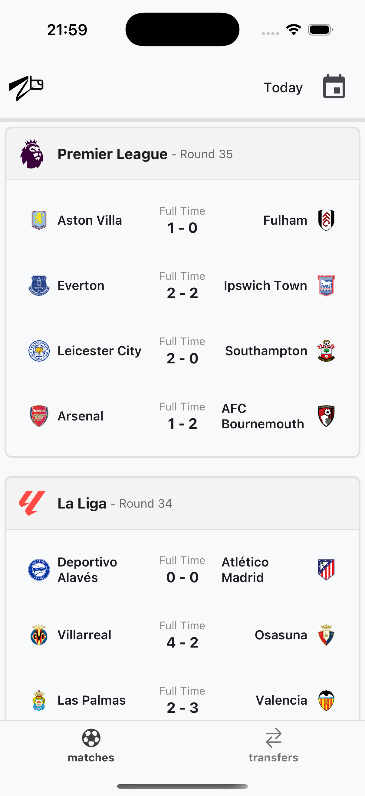
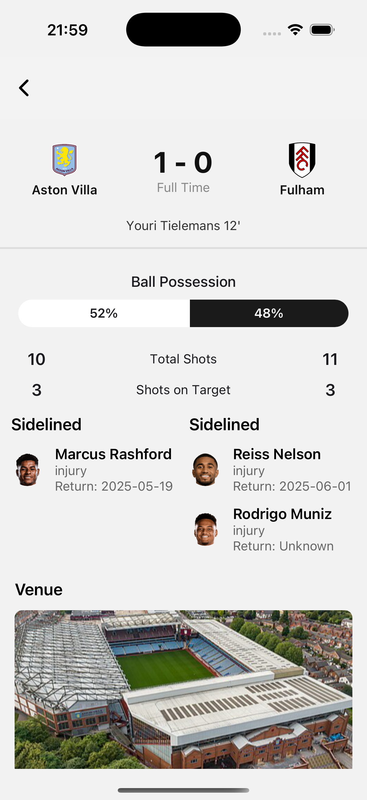

# Football Scores

A mobile app for following football fixtures, standings, top scorers and transfers.
Built with Expo and React Native for iOS and Android.

> Portfolio project. Data comes from the SportMonks Football API (free plan).

## Demo

<p align="center">
  
  
  
</p>

<!-- Once recorded, put a short screen capture above the screenshots:
  
-->

## Features

- **Matches** — fixtures grouped by league for any date, chosen from a calendar in a bottom sheet
- **Match details** — score and periods, venue, weather report, sidelined players
- **Leagues** — standings table with recent form, and season top scorers
- **Teams** — club info, full squad, upcoming fixtures, sidelined players
- **Players** — bio and season statistics
- **Transfers** — latest transfer activity

Loading states are skeleton placeholders rather than spinners, so the layout does
not shift when data arrives.

## Tech

Expo SDK 58 · React Native 0.88 · React 19 · TypeScript · Expo Router (typed routes) ·
React Native Paper · React Native Calendars · @gorhom/bottom-sheet · Reanimated · Moti · date-fns

Choices worth explaining:

- **Expo Router with typed routes** — screens are files, and route params such as
  `/match/[fixtureID]` are type-checked where they are used.
- **@gorhom/bottom-sheet for the date picker** — the calendar overlays the fixture
  list instead of replacing it, so the list keeps its scroll position.
- **Moti skeletons instead of spinners** — placeholders match the shape of the
  content they replace, which avoids layout jumps.

## Architecture

```
app/              Expo Router routes: (tabs), league/[seasonID], match/[fixtureID],
                  team/[teamID], player/[playerID]
components/       UI grouped by domain: Match, Fixture, League, Team, Player, Transfer
lib/api.ts        every network call to the SportMonks API
types/types.ts    TypeScript interfaces for the API payloads
```

All requests live in `lib/api.ts` — no screen or component calls the network
directly. Each endpoint is a single exported function (`fetchMatchesByDate`,
`fetchLeagueStandings`, `fetchTopScorers`, `fetchMatchInfo`, …), so changing a URL
or the `include` parameters of a query means editing one file.

The API base URL and token are read from `.env` via `app.config.ts` and
`expo-constants`. No credentials are committed.

## Running locally

```bash
npm install
cp .env.example .env     # add your SportMonks API token
npx expo start
```

Then press `i` for the iOS simulator, `a` for Android, or scan the QR code with Expo Go.

## Known limitations and next steps

- Components consume the API payload shape directly — `types/types.ts` mirrors the
  SportMonks response, including fields the app never uses. Mapping responses onto
  app-level types inside `lib/` would decouple the UI from the provider.
- The fetch functions repeat the same request and error-handling block eight times;
  that belongs in one shared `request()` helper.
- No automated tests yet, although `jest-expo` is already configured.
- The free API plan covers a limited set of leagues and delays some data.
