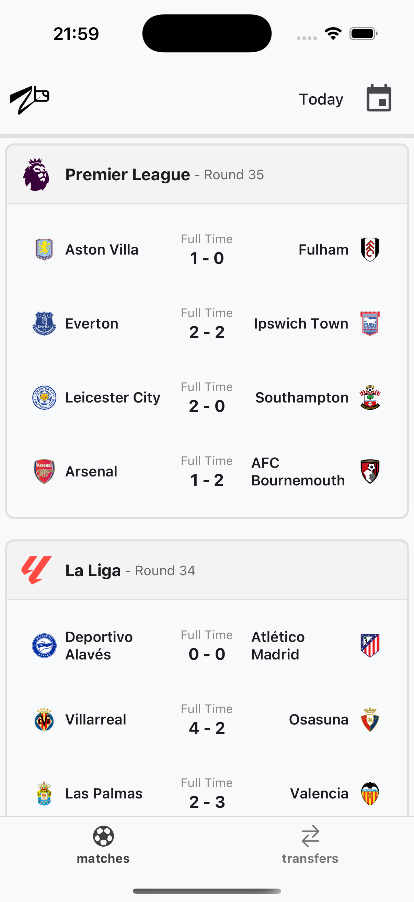
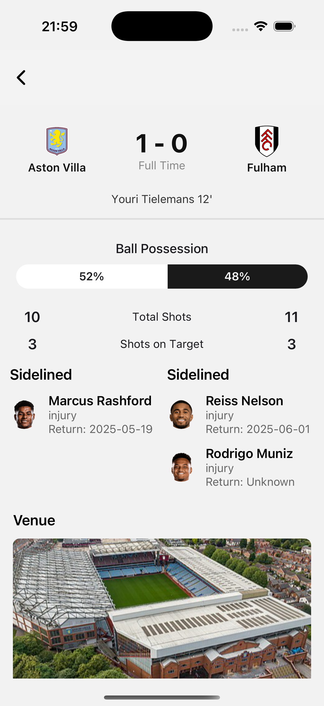
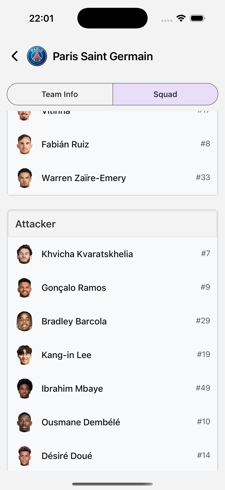
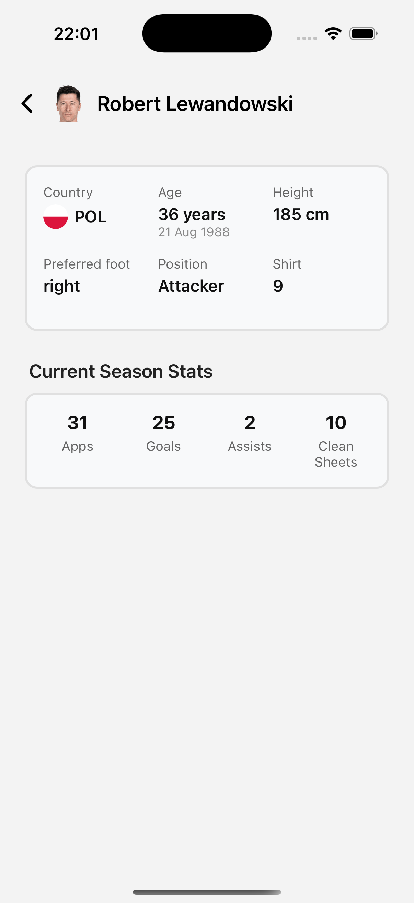

# Football Scores

A mobile app for following football fixtures, results, standings, squads and transfers.
Built with Expo and React Native for iOS and Android.

Data comes from the [SportMonks Football API](https://www.sportmonks.com/) (free plan).

## Screenshots

<p align="center">
  
  
  
  
</p>

<p align="center">
  <em>More screens in <a href="docs/screenshots">docs/screenshots</a>: live match, team info, transfers.</em>
</p>

## Features

- **Matches** — fixtures for any date, grouped by competition and round; the date is
  picked from a calendar that opens in a bottom sheet
- **Match details** — score and goalscorers, ball possession, shots and shots on
  target, sidelined players for both sides, and the venue
- **Leagues** — standings table with recent form, and season top scorers
- **Teams** — club info, upcoming fixtures, sidelined players, and the full squad
  grouped by position
- **Players** — profile (country, age, height, preferred foot, position, shirt
  number) and current-season statistics
- **Transfers** — latest transfers with fee and transfer type

While data is loading the app renders skeleton placeholders shaped like the content
they replace, so the layout does not jump once the response arrives.

## Tech

Expo SDK 58 · React Native 0.88 · React 19 · TypeScript · Expo Router (typed routes) ·
React Native Paper · React Native Calendars · @gorhom/bottom-sheet · Reanimated · Moti · date-fns

Choices worth explaining:

- **Expo Router with typed routes** — screens are files, and route parameters such as
  `/match/[fixtureID]` are type-checked where they are used rather than passed as
  loose strings.
- **@gorhom/bottom-sheet for the date picker** — the calendar overlays the fixture
  list instead of navigating away from it, so the list keeps its scroll position
  when the user changes the date.
- **Moti skeletons instead of spinners** — the placeholder has the shape of the
  content it stands in for, which avoids a layout shift when data arrives.

## Project structure

```
app/              Expo Router routes
                    (tabs)/matches, (tabs)/transfers
                    league/[seasonID], match/[fixtureID]
                    team/[teamID], player/[playerID]
components/       UI grouped by domain: Match, Fixture, League, Team, Player, Transfer
lib/api.ts        every network call to the SportMonks API
types/types.ts    TypeScript interfaces for the API payloads
```

All network access lives in `lib/api.ts` — no screen or component calls the API
directly. Each endpoint is a single exported function (`fetchMatchesByDate`,
`fetchLeagueStandings`, `fetchTopScorers`, `fetchMatchInfo`, `fetchPlayerByID`,
`fetchFullParticipantInfo`, `fetchTransfersLatest`), so changing an endpoint or the
`include` parameters of a query means editing one file.

The API base URL and token are read from `.env` through `app.config.ts` and
`expo-constants`, so no credentials are committed.

## Running locally

```bash
npm install
cp .env.example .env     # add your SportMonks API token
npx expo start
```

Then press `i` for the iOS simulator, `a` for an Android emulator, or scan the QR
code with Expo Go on a device.

## Known limitations and next steps

- Components consume the API payload shape directly: `types/types.ts` mirrors the
  SportMonks response, including fields the app never reads. Mapping responses onto
  app-level types inside `lib/` would decouple the UI from the provider.
- The fetch functions repeat the same request and error-handling block; that belongs
  in one shared `request()` helper.
- No automated tests yet, although `jest-expo` is already configured.
- The free API plan covers a limited set of competitions and delays some data.
